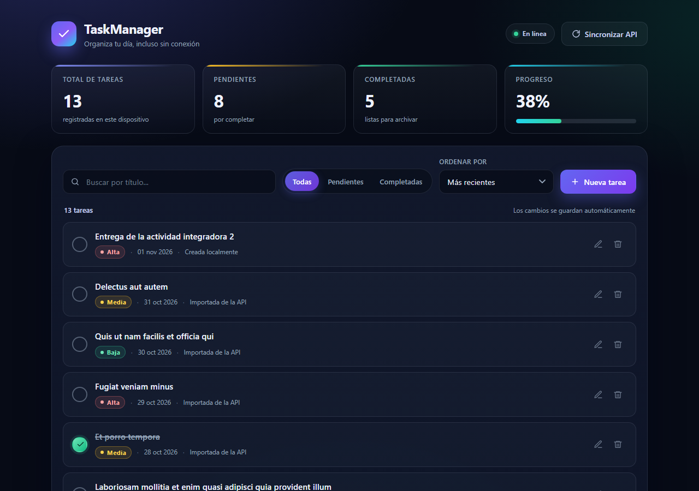

# TaskManager — JavaScript Vanilla

Aplicación de gestión de tareas construida con **JavaScript Vanilla (ES6+)**, sin frameworks ni librerías. Consume la API pública de [JSONPlaceholder](https://jsonplaceholder.typicode.com/todos), persiste todo en `localStorage` y sigue funcionando sin conexión después de la primera carga.

El eje de investigación técnica es la **Opción A: Arquitectura Modular ES6** (`import` / `export`), con una separación estricta entre interfaz, estado, servicio API y almacenamiento.



## Demo

- **Repositorio:** https://github.com/carlosvillegas2733-rgb/taskmanager-vanilla
- **GitHub Pages:** https://carlosvillegas2733-rgb.github.io/taskmanager-vanilla/

## Funcionalidades

| Requisito de la actividad | Implementación | Archivo |
| --- | --- | --- |
| CRUD completo (crear, editar, eliminar, completar) | `addTask`, `updateTask`, `removeTask`, `toggleTask` + diálogos y confirmación | `js/modules/taskStore.js`, `js/modules/ui.js` |
| Validación estricta de campos vacíos | Título obligatorio, mínimo 3 y máximo 80 caracteres; prioridad obligatoria y válida | `js/modules/validation.js` |
| Filtros por estado y búsqueda en tiempo real | `filter` + `includes` + `toLowerCase` sobre el arreglo de tareas | `js/modules/taskStore.js` |
| Ordenamiento por fecha y prioridad | `sort()` con comparadores y pesos `alta > media > baja` | `js/modules/taskStore.js` |
| Métricas y dashboard reactivo | Total, pendientes, completadas y porcentaje de progreso; se recalculan en cada render | `js/modules/taskStore.js`, `js/modules/ui.js` |
| Carga inicial desde la API | `fetch()` + `async/await`; se importa solo si `localStorage` está vacío | `js/modules/api.js`, `js/app.js` |
| Sin duplicar registros | Deduplicación por `apiId` con un `Set` | `js/modules/taskStore.js` |
| Manejo de errores de red | `try/catch` + `AbortController` con timeout de 8 s y notificación visual | `js/modules/api.js`, `js/app.js`, `js/modules/ui.js` |
| Persistencia local | `JSON.stringify` / `JSON.parse` sobre la clave `taskmanager.tasks.v1` | `js/modules/storage.js` |
| Modo offline | Si la API falla, la app sigue operando con lo guardado en el navegador | `js/app.js` |

## Arquitectura modular (Opción A)

```text
index.html
css/
  styles.css
js/
  app.js                  Punto de entrada: arranque, sincronización y eventos de red
  modules/
    api.js                Servicio de API (fetch + mapeo de datos remotos)
    storage.js            Adaptador de localStorage (único módulo que toca Web Storage)
    validation.js         Reglas de validación reutilizables
    taskStore.js          Estado en memoria + CRUD + filtros + orden + métricas
    ui.js                 Render del DOM, eventos de interfaz y notificaciones
tests/
  taskStore.test.mjs      Pruebas de la lógica con Node (sin navegador)
docs/
  captures/               Capturas usadas en el informe
```

**Dirección de dependencias:** `app.js → ui.js → taskStore.js → storage.js` y `app.js → api.js → validation.js`. Ningún módulo de UI importa la API ni el almacenamiento de forma directa. `storage.js` es el único punto de contacto con `localStorage` y `api.js` el único con `fetch`.

### Responsabilidad de cada módulo

| Módulo | Responsabilidad | No hace |
| --- | --- | --- |
| `api.js` | Pedir los todos, validar la respuesta y mapearla al modelo local | No guarda ni renderiza |
| `storage.js` | Leer, validar y escribir la lista en `localStorage` | No conoce reglas de negocio |
| `validation.js` | Validar el formulario de tarea | No toca el DOM |
| `taskStore.js` | Fuente única de verdad: CRUD, filtros, búsqueda, orden y métricas | No toca el DOM ni la API |
| `ui.js` | Renderizar el estado y traducir gestos del usuario en operaciones | No decide reglas de negocio |
| `app.js` | Orquestar el arranque, la sincronización y los eventos `online`/`offline` | No contiene lógica de negocio |

## Modelo de datos

```json
{
  "id": "5f1c2b7e-8a4d-4c1e-9b2f-3d6a1c8e9f01",
  "apiId": 4,
  "title": "Et porro tempora",
  "completed": true,
  "priority": "media",
  "createdAt": "2026-10-28T14:32:00.000Z",
  "source": "api"
}
```

- Las tareas locales usan un `id` generado con `crypto.randomUUID()`.
- Las tareas de la API conservan su `apiId` numérico: es la clave de deduplicación.
- `priority` y `createdAt` no existen en JSONPlaceholder; se derivan de forma determinista al importar.

## Flujo de datos

1. `app.js` lee `localStorage` y arranca el store con lo que haya.
2. Si no hay nada guardado, consulta la API, mapea los datos y los importa sin duplicar.
3. Cualquier modificación valida, actualiza el arreglo, escribe en `localStorage` y vuelve a renderizar las métricas y la lista.
4. Si la red falla, se muestra una notificación y la app continúa con los datos locales.

## Cómo ejecutar

> **Importante:** los módulos ES6 no funcionan abriendo `index.html` con doble clic (`file://`), porque el navegador bloquea los `import` por CORS. Necesitas servir la carpeta por HTTP.

Opciones:

```bash
# Opción 1: Node
npx serve .

# Opción 2: Python
python -m http.server 5500
```

Luego abre `http://localhost:3000` o `http://localhost:5500` según corresponda. En VS Code también sirve la extensión **Live Server**.

## Pruebas

La lógica del store, la validación y la lectura de `localStorage` están cubiertas con pruebas ejecutables en Node (con un stub de `localStorage`, sin dependencias):

```bash
npm test
```

Resultado esperado: `19 passed, 0 failed`.

## Decisiones técnicas

- **Sin dependencias de producción.** Solo el navegador: `fetch`, `localStorage`, `Intl`, `dialog` y módulos ES6.
- **Seguridad del render.** Las tareas se construyen con `createElement` y `textContent`; no se interpola texto del usuario con `innerHTML`.
- **Datos remotos incompletos.** JSONPlaceholder no trae prioridad ni fecha, así que se derivan al importar para que el ordenamiento tenga sentido.
- **Deduplicación explícita.** El `Set` de claves (`apiId` o `id`) evita duplicados aunque se pulse "Sincronizar API" varias veces.
- **Almacenamiento tolerante a fallos.** Si el JSON guardado está corrupto o una entrada no cumple el modelo, se descarta en lugar de romper la app.
- **Accesibilidad.** Diálogos nativos, etiquetas asociadas, `aria-live` para notificaciones y foco gestionado en el formulario.

## Nota de entrega

El proyecto se desarrolló localmente y se publicó en GitHub el día de la entrega. El historial se organizó en commits por etapas (estructura, CRUD y persistencia, API y errores, filtros y métricas, documentación y evidencias).

## Autor

Carlos Villegas — Programación de Sistemas Web, ECOTEC.
